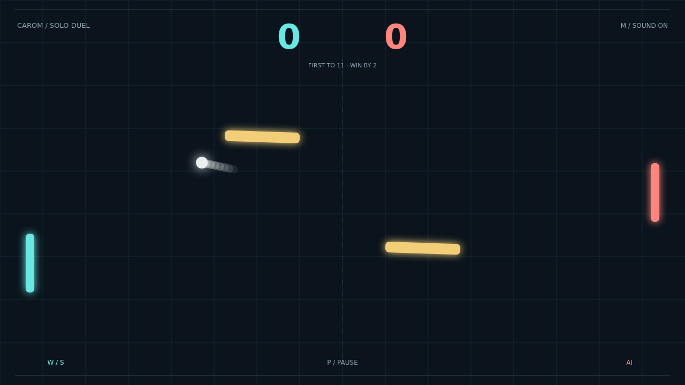

# Carom

Every return is a chance to change the angle. Carom puts two bright paddles across a dark court, with a pair of rotating gold obstacles between them. Face the AI in Solo or challenge a friend on the same keyboard.

The opening serve gives you a moment to settle into position. Catch the ball at your paddle's center for a clean return, or near its edge to send it climbing toward the wall. Each paddle hit makes the rally faster.

Move as you strike and your return gains spin. The flight bends, turning a familiar shot into something your opponent has to read again. Bank off a tilted obstacle to send the ball along an unexpected route through the court.

Stay composed as the score climbs. First to eleven wins, but a tied match demands a two-point lead. The next sliding return could open the path to match point.

